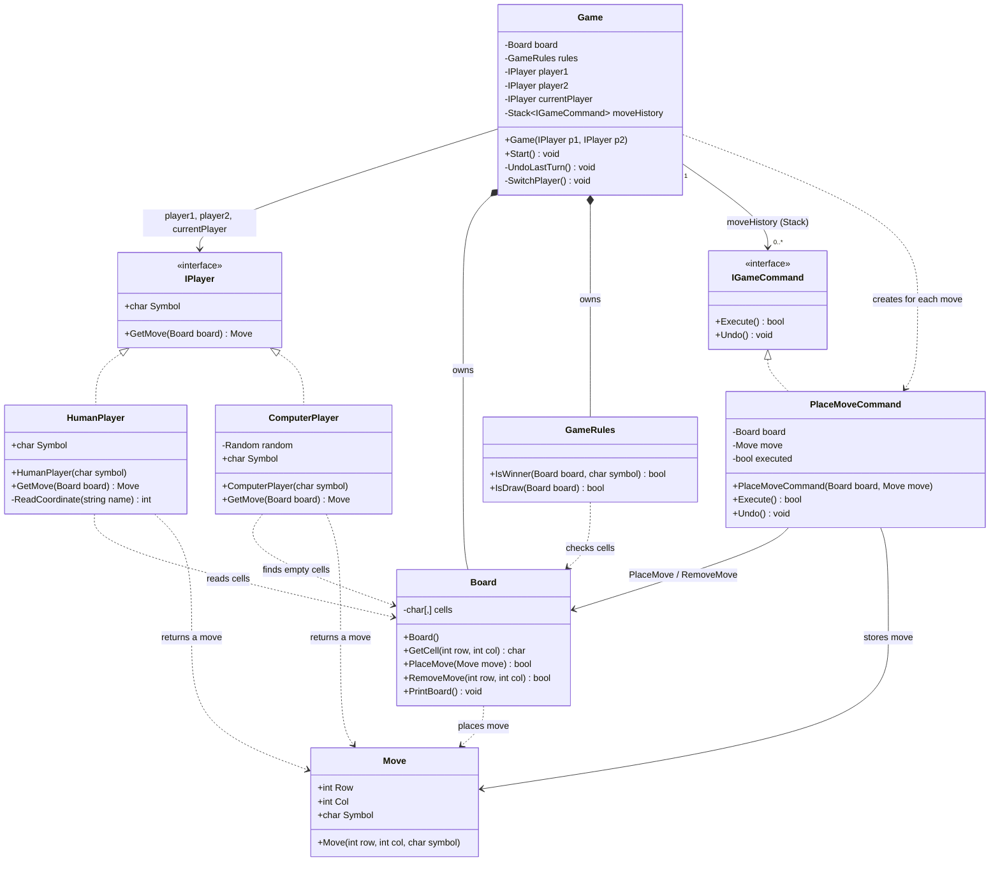
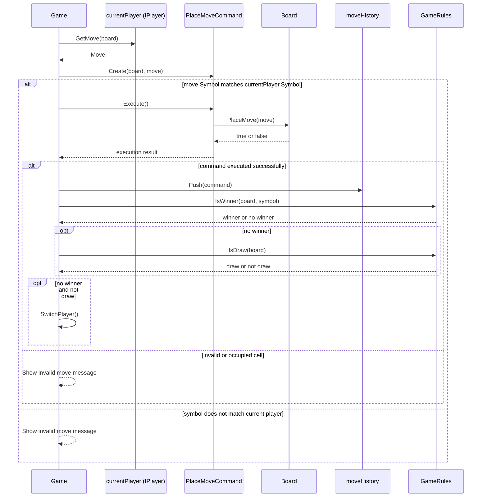
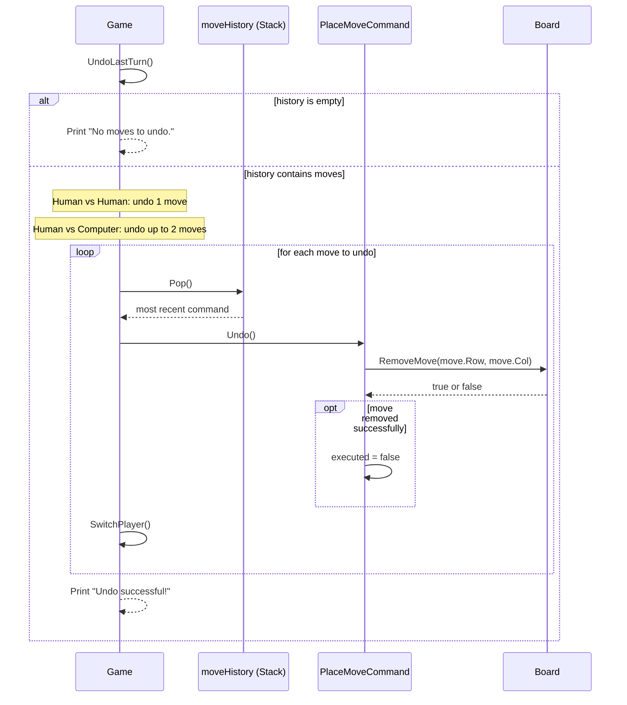

# Tic-Tac-Toe UML — Command Pattern and Undo

This UML describes the classes and methods currently implemented in the project. The Command Pattern is used to execute a move and reverse it when the player chooses Undo.

## 1. Class Diagram

## 2. Command Pattern Roles

| Role | Implemented class | Responsibility |
|---|---|---|
| Invoker | `Game` | Creates a `PlaceMoveCommand`, calls `Execute()`, and stores successful commands in `moveHistory`. |
| Command interface | `IGameCommand` | Defines `Execute()` and `Undo()`. |
| Concrete command | `PlaceMoveCommand` | Stores the target `Board` and `Move`. `Execute()` places the move; `Undo()` removes it if the command was executed. |
| Receiver | `Board` | Owns the cells and provides `PlaceMove()` and `RemoveMove()`. |
| Command history | `Stack<IGameCommand>` in `Game` | Stores successful moves. `Pop()` makes Undo follow LIFO order. |

## 3. Sequence Diagram — Execute a Move

## 4. Sequence Diagram — Undo

## 5. Undo Behavior in the Current Code

- Only successful move commands are pushed onto `moveHistory`.
- `UndoLastTurn()` pops the newest command first, so commands are undone in Last-In, First-Out (LIFO) order.
- In Human vs Human mode, Undo reverses one move.
- In Human vs Computer mode, Undo reverses up to two moves, depending on how many commands are in history.
- `PlaceMoveCommand.Undo()` calls `Board.RemoveMove()` only when its command has been executed.
- An empty history prints `No moves to undo.` and returns without changing the board.

## 6. Other OOP Relationships

- **Encapsulation:** `Board` keeps its `cells` array private and changes board state through its methods.
- **Polymorphism:** `Game` works with `IPlayer` references, which can refer to either `HumanPlayer` or `ComputerPlayer`.
- **Command Pattern:** `Game` can store and undo commands through `IGameCommand` without needing the history to depend on command implementation details.
- **Separation of responsibilities:** `Board` manages cells, `GameRules` checks wins and draws, player classes provide moves, and `Game` manages turns and Undo.