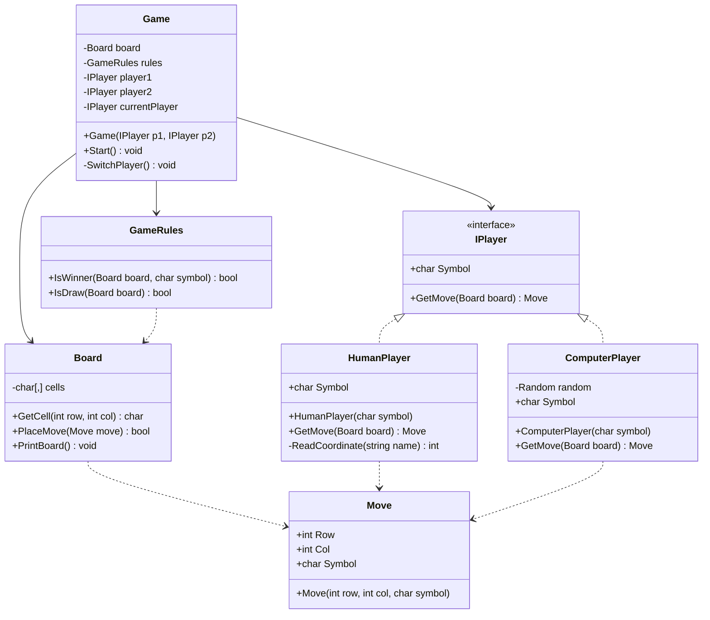

# Week 1 class diagram (simplified)
# UML Class Diagram — Week 2

## OOP Principles

- Encapsulation: Board stores cells privately.
- Polymorphism: Game uses IPlayer to work with both HumanPlayer and ComputerPlayer.
- Single Responsibility: Player classes generate moves, Board manages board state, GameRules checks win/draw, and Game manages turns.

## Next Week

Implement undo using a move-history stack and improve separation of console display from Board.
