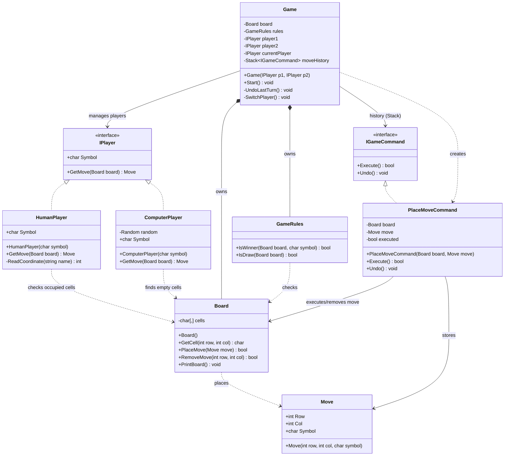
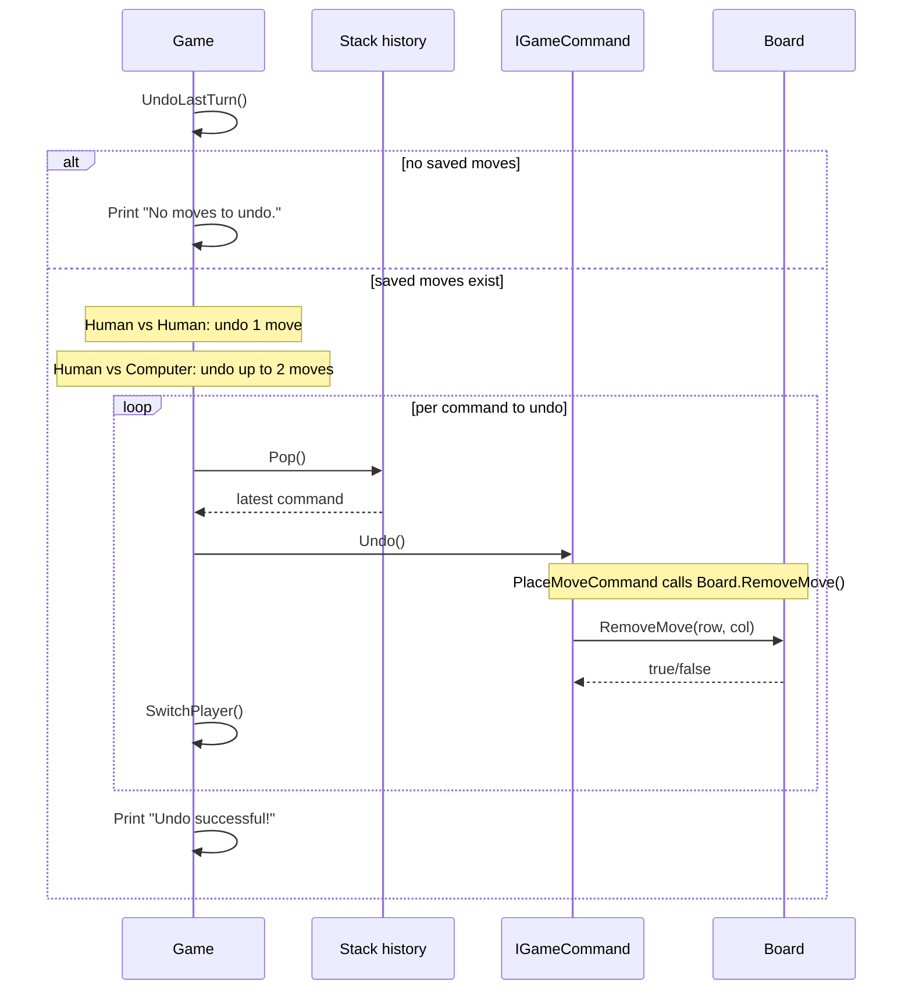

# Tic-Tac-Toe OOP — UML Class Diagram (Week 3)

This document describes the implemented C# (.NET 8) architecture, including the Command Pattern used for Undo.

## 1. Class Diagram



## 2. Command Pattern Roles

| Role | Component | Responsibility |
|---|---|---|
| Command | `IGameCommand` | Defines `Execute()` and `Undo()` |
| Concrete Command | `PlaceMoveCommand` | Stores a move and executes/reverses it |
| Receiver | `Board` | Changes cells through `PlaceMove()` and `RemoveMove()` |
| Invoker | `Game` | Creates commands and invokes execution/undo |
| History | `Stack<IGameCommand>` | Tracks successful moves in LIFO order |

## 3. Move Execution Sequence

```mermaid
sequenceDiagram
    participant G as Game
    participant P as IPlayer
    participant C as PlaceMoveCommand
    participant B as Board
    participant H as Stack history
    participant R as GameRules
    G->>P: GetMove(board)
    P-->>G: move
    G->>C: new PlaceMoveCommand(board, move)
    alt move symbol matches current player
        G->>C: Execute()
        C->>B: PlaceMove(move)
        B-->>C: true/false
        C-->>G: success/failure
        alt success
            G->>H: Push(command)
            G->>R: IsWinner(board, symbol)
            opt no winner
                G->>R: IsDraw(board)
            end
            opt no winner and no draw
                G->>G: SwitchPlayer()
            end
        else invalid move
            G->>G: Display error; retry turn
        end
    else wrong symbol
        G->>G: Display error; retry turn
    end
```

## 4. Undo Sequence



## 5. Implemented Behavior and Limitations

- A command is pushed onto the history stack only after its `Execute()` succeeds.
- Undo reverses the most recent successful command first (LIFO).
- Human vs Human undoes one move and restores the turn.
- Human vs Computer undoes up to two moves at a time, restoring the human player's turn in normal play.
- If history is empty, no move is changed and a message is displayed.
- Undo is offered at a separate prompt during an active game, not after a win/draw has ended the game.
- `Board` still handles console rendering; separation of presentation is future work.

## 6. Testing

- `Week1Tests.cs`: 7 core checks.
- `PlayerTests.cs`: 3 player-related checks.
- `UndoTests.cs`: 5 Undo checks; uses reflection to access private Game members for tests.

Test outcomes are reported separately based on actual execution, not inferred from this UML.
